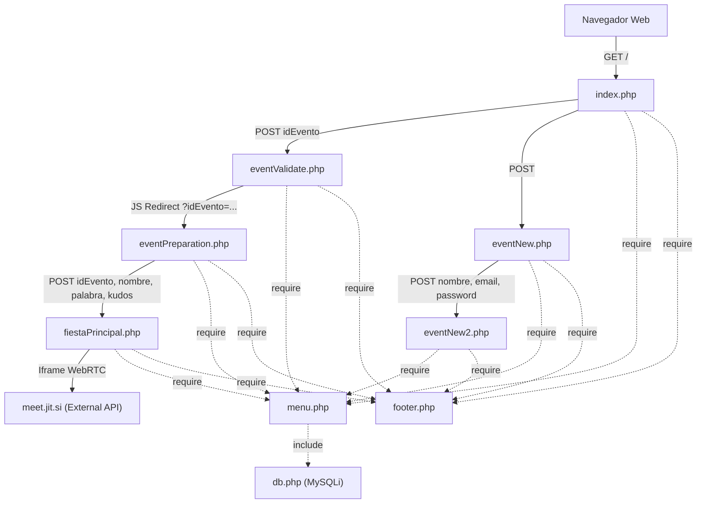

# 00 · Arquitectura del Sistema y Alineación con Pautas Técnicas

**Requisitos cubiertos:** `RF-02`, `RF-11`, `RF-12`, `RNF-01`, `RNF-02`, `RNF-03`, `RNF-04`, `RNF-05`, `RNF-06`, `RNF-07`, `RNF-08`.

---

## 1. Stack Tecnológico Real

El análisis del repositorio muestra una aplicación web tradicional multipágina (**MPA**) construida sin frameworks de backend ni herramientas de empaquetado modernas:

| Capa | Tecnología / Librería | Versión / Detalle | Evidencia |
| :--- | :--- | :--- | :--- |
| **Lenguaje de Servidor** | PHP (procedural, embebido en HTML) | PHP 7.x / 8.x (uso de short echo tags `<?= ?>` y extensión `mysqli`) | `*.php` |
| **Base de Datos** | MySQL / MariaDB | Conector procedural `mysqli_connect`, `mysqli_query` | `db.php`, `eventValidate.php` |
| **Plantilla UI / Estilos** | HTML5 UP — *Phantom* | CSS3 + fuentes Sass en `CSSPhantom/assets/sass/` + FontAwesome 5 | `CSSPhantom/README.txt`, `CSSPhantom/assets/css/main.css` |
| **Scripting Cliente** | JavaScript ES5/ES6 + jQuery | jQuery `3.5.1` (CDN `code.jquery.com`) + copia local en `CSSPhantom/assets/js/jquery.min.js` | `index.php`, `eventNew.php`, `eventNew2.php`, `fiestaPrincipal.php` |
| **Videoconferencia** | Jitsi Meet IFrame API | `https://meet.jit.si/external_api.js` (`JitsiMeetExternalAPI`) | `fiestaPrincipal.php` |

---

## 2. Arquitectura y Estructura del Repositorio

La aplicación carece de separación física en capas (Controlador / Servicio / Dominio / Repositorio). Cada archivo `.php` en la raíz actúa simultáneamente como punto de entrada HTTP, controlador de recepción de parámetros (`$_POST` / `$_GET`), ejecutor de consultas SQL y vista HTML.

```text
.
├── db.php                    # Configuración y apertura de conexión MySQL ($link)
├── menu.php                  # Fragmento de navegación lateral (<nav id="menu">); incluye db.php
├── footer.php                # Fragmento de pie de página común (<footer id="footer">)
├── index.php                 # Portada con accesos para Invitado, Nuevo Evento y Administración
├── eventValidate.php         # Validador SQL de código de evento y ventana horaria (-30 min)
├── eventPreparation.php      # Antesala del invitado (captura de nombre, palabra y kudos)
├── fiestaPrincipal.php       # Sala del evento con videollamada embebida Jitsi Meet
├── eventNew.php              # Paso 1 de creación de evento: datos del organizador
├── eventNew2.php             # Paso 2 de creación de evento: fecha, horas y cálculo de precio
├── generic.php               # Plantilla de página genérica estática
├── images/                   # Recursos gráficos propios del proyecto (confeti, robot, iconos)
├── CSSPhantom/               # Plantilla base "Phantom by HTML5 UP" (CSS, JS, Webfonts, demos)
└── EJEMPLOS.txt              # Archivo de notas de desarrollo (fragmento SQL y volcado Jitsi)
```

### Flujo de Inclusión y Ciclo de Vida de Petición



---

## 3. Configuración y Variables de Entorno Detectadas

El proyecto **no utiliza archivos `.env` ni variables de entorno del sistema (`getenv` / `$_ENV`)**. En su lugar, emplea detección del encabezado `$_SERVER['HTTP_HOST']` directamente en `db.php`:

| Parámetro / Variable | Origen en Código | Comportamiento Detectado | Riesgo / Observación |
| :--- | :--- | :--- | :--- |
| `$_SERVER['HTTP_HOST']` | `db.php` (línea 6) | Si es `'localhost'`, conecta a MySQL local (`root` sin contraseña, BD `eventosonline`). En cualquier otro caso, conecta a `127.0.0.1:3306` con credenciales de producción. | Credenciales de producción expuestas en texto plano en el código fuente (`db.php`, líneas 9-10). |
| `$preciohora` | `eventNew2.php` (línea 106) | Constante de negocio definida en línea (`$preciohora = 10;`) e inyectada en el cálculo JavaScript. | Debería parametrizarse en configuración o tabla de tarifas. |
| `domain` (Jitsi) | `fiestaPrincipal.php` (línea 29) | Constante JS `const domain = 'meet.jit.si';`. | Acoplado en la vista en lugar de residir en configuración centralizada. |

---

## 4. Contraste con Convenciones Locales y Directivas Corporativas de Cauce

No existen archivos `README.md` (en la raíz), `CLAUDE.md` ni `AGENTS.md` con normas locales del repositorio. A continuación se contrasta la arquitectura real del repositorio frente a las **32 pautas técnicas activas** definidas en `.cauce/pautas-tecnicas.json` (incluyendo las 8 transversales con `alwaysApply: true`):

### 4.1. Pautas Transversales (`alwaysApply: true`)

| ID Pauta | Categoría | Título de la Pauta | Estado en el Repositorio | Evidencia / Hallazgo en el Código Real |
| :--- | :--- | :--- | :--- | :--- |
| `cmvibkx2000304wr8xvqpojmt` | `general` | **Clean Code y Principio KISS** | **Parcial / Bajo** | Aunque los scripts son cortos, existe duplicación de cabeceras `<head>` y carga duplicada de jQuery (CDN en `<head>` y archivo local al final de `<body>`) en todas las vistas, código muerto comentado en `index.php`, `footer.php` y `EJEMPLOS.txt`, y acoplamiento de `include 'db.php'` dentro de `menu.php`. |
| `cmvibkx2000314wr858dcqnj0` | `general` | **Arquitectura Hexagonal y Separación de Capas** | **No cumple** | No existe separación entre dominio, aplicación e infraestructura. Las consultas SQL (`mysqli_query`), las reglas de negocio (ventana de 30 min, cálculo de tarifa) y el renderizado HTML conviven en los mismos archivos PHP. |
| `cmvibkx2000324wr8b2fmn57s` | `general` | **Idempotencia y Operaciones Atómicas** | **No cumple** | No existen transacciones SQL ni claves de idempotencia; la persistencia del alta de eventos en `eventNew2.php` ni siquiera está implementada. |
| `cmvibkx21003k4wr8iuo80xeh` | `definition_of_done` | **Comprobaciones Automatizadas en Verde** | **No cumple** | El proyecto no cuenta con linter (PHPCS/PHPStan/ESLint), compilación de tipos ni suite de pruebas automatizadas. |
| `cmvibkx21003l4wr8jzp9pdk4` | `definition_of_done` | **Ausencia de Secretos y Deuda Bloqueante** | **No cumple (Crítico)** | `db.php` (líneas 9-10) contiene usuarios y contraseñas reales de MySQL codificados en texto plano en el repositorio. Además existen flujos incompletos con `action="#"` en `index.php` y `eventNew2.php`. |
| `cmvibkx21003m4wr8200y3anq` | `definition_of_done` | **Validación Funcional Extremo a Extremo** | **No cumple** | El flujo de creación de evento (`eventNew2.php`) falla en cliente por un error de sintaxis/API en JavaScript (`Today.diff` y `.Value`), y el flujo de administración en `index.php` no tiene implementación. |
| `cmvibkx21003g4wr8je79nqhw` | `qa` | **Implementación de Tests Automáticos** | **No cumple** | No existe ningún test unitario, de integración ni E2E en el repositorio. |
| `cmvibkx21003j4wr864ajbee3` | `qa` | **Tests de Regresión para Bugs Resueltos** | **No cumple** | Sin infraestructura de testing automatizado. |

### 4.2. Pautas Específicas por Categoría (`alwaysApply: false`)

| ID Pauta | Categoría | Título de la Pauta | Estado en el Repositorio | Evidencia / Hallazgo en el Código Real |
| :--- | :--- | :--- | :--- | :--- |
| `cmvibkx2000374wr8p06zxfrd` | `backend` | **Manejo Temporal en UTC y Fechas Relativas con Timezone** | **No cumple** | `eventValidate.php` combina `NOW()` de MySQL con `time()` y `strtotime()` de PHP sin fijar zona horaria ni usar UTC. |
| `cmvibkx2100384wr8ltebwaag` | `backend` | **Sincronización Estricta de Contratos y Enums** | **No cumple** | Sin esquemas de validación en servidor. De hecho, existe desincronización entre el patrón del código de evento en acceso de invitados (`[a-zA-Z0-9]{9}`) y en administración (`[a-z0-9]{11}`) en `index.php`. |
| `cmvibkx2100394wr8wuic7q1e` | `backend` | **Manejo Defensivo de Excepciones** | **No cumple (Crítico)** | `db.php` ejecuta `die("ERROR: Could not connect. " . mysqli_connect_error())` y `eventValidate.php` imprime `echo "ERROR: Could not able to execute $sql. " . mysqli_error($link)`, exponiendo consultas SQL y errores internos al usuario final. |
| `cmvibkx2000334wr8cin6uy7v` | `database` | **Migraciones de Esquema Versionadas** | **No cumple** | No existen archivos de migración SQL ni definición de esquema en el repositorio (el archivo `EJEMPLOSQL.txt` fue eliminado en el commit `e2630d1`). |
| `cmvibkx2000344wr8l99nil0n` | `database` | **Integridad Referencial y Claves Foráneas** | **No aplicable / Sin esquema** | Solo se evidencia una única tabla `eventos` sin tablas relacionadas persistidas. |
| `cmvibkx2000354wr8htjzsrts` | `database` | **Indexación Estratégica** | **No verificable en repo** | Al no existir DDL versionado, no consta la definición de índices sobre `idEvento`, `enabled` o `fechaHoraFin`. Se documenta su recomendación en `specs/01-datos.md`. |
| `cmvibkx2000364wr8u906eabq` | `database` | **Prohibición de SQL Crudo sin Parametrizar** | **No cumple (Crítico)** | `eventValidate.php` (línea 59) concatena directamente `$_POST["idEvento"]` en la cadena SQL (`WHERE idEvento = '".$idEvento."'`), introduciendo una vulnerabilidad directa de inyección SQL. |
| `cmvibkx21003n4wr8nwn9wlqr` | `documentation` | **Actualización de Documentación de Arquitectura y APIs** | **Cubierto en esta iteración** | El repositorio carecía de `README.md`, `docs/` y `specs/`. Se subsana mediante esta ingeniería inversa. |
| `cmvibkx21003o4wr8ikjpryn6` | `documentation` | **Registro de Decisiones Arquitectónicas (ADR)** | **No cumple** | No existían registros de decisiones arquitectónicas previos. |
| `cmvibkx21003a4wr852aqj6pi` | `frontend` | **Uso Exclusivo del Design System y Tokens** | **Parcial** | Se utiliza de forma mayoritaria la hoja de estilos de la plantilla `CSSPhantom/assets/css/main.css`, aunque se mezclan etiquetas obsoletas como `<center>`, atributos `align="center"` y múltiples `<br><br><br>` para espaciado vertical. |
| `cmvibkx21003b4wr8bgov3cxu` | `frontend` | **Estados de Carga, Error y Datos Vacíos** | **Parcial** | `eventValidate.php` contempla mensajes específicos para código inválido y llegada temprana, pero la carga del iframe de Jitsi Meet en `fiestaPrincipal.php` no muestra indicador de carga ni estado de error si falla `external_api.js`. |
| `cmvibkx21003c4wr8o8hlejh6` | `frontend` | **Accesibilidad Web WCAG 2.1 AA** | **No cumple** | Ninguno de los campos `<input>` o `<textarea>` en `index.php`, `eventNew.php`, `eventNew2.php` o `eventPreparation.php` tiene etiquetas `<label for="...">` asociadas (dependen únicamente de `placeholder` o texto suelto), las imágenes carecen de texto alternativo descriptivo (`alt=""`) y en `index.php` se duplica `id="demo-name"`. |
| `cmvibkx21003s4wr85nl7g8f4` | `observability` | **Logging Estructurado con Contexto** | **No cumple** | No existe sistema de logging en servidor; los errores se vuelcan con `echo` o `die()` en la respuesta HTML. |
| `cmvibkx21003t4wr8flvcogub` | `observability` | **Telemetría de Eventos Clave de Negocio** | **No cumple** | No se registran eventos de acceso exitoso, intentos fallidos ni conversiones de solicitud de eventos. |
| `cmvibkx21003u4wr82zuseaz4` | `performance` | **Prevención de Consultas N+1** | **Cumple (Trivial)** | La única consulta SQL en `eventValidate.php` es una consulta puntual sobre la tabla `eventos` sin bucles de consultas anidadas. |
| `cmvibkx21003v4wr8fhr8vj1t` | `performance` | **Paginación Obligatoria en Listados** | **No aplicable** | Actualmente no existen pantallas de listado de eventos en la aplicación. |
| `cmvibkx21003h4wr8hnmv2sfu` | `qa` | **Testing con Entornos Realistas** | **No cumple** | Sin suite de pruebas. |
| `cmvibkx21003i4wr8c3phozya` | `qa` | **Matriz de Pruebas de Roles y Estados** | **No cumple** | Sin pruebas automatizadas que verifiquen los estados del evento (inactivo, temprano, en hora, expirado). |
| `cmvibkx21003p4wr8dehwk0iz` | `security` | **Almacén Cifrado de Credenciales y Secretos** | **No cumple (Crítico)** | Credenciales MySQL en claro en `db.php` y contraseñas de organizador transmitidas sin hash y reenviadas en `<input type="hidden" name="password">` en `eventNew2.php`. |
| `cmvibkx21003q4wr8siicj2z7` | `security` | **Validación y Sanitización de Entradas** | **No cumple (Crítico)** | La validación se realiza únicamente en cliente (`pattern` HTML5 o `validarFormulario` en JS). En servidor (`eventValidate.php`, `eventPreparation.php`, `fiestaPrincipal.php`, `eventNew2.php`), las variables `$_POST` y `$_GET` se usan sin validación ni sanitización, permitiendo SQLi y XSS reflejado. |
| `cmvibkx21003r4wr8q9xcln1c` | `security` | **Control de Acceso y Mínimo Privilegio** | **No cumple** | `eventPreparation.php` y `fiestaPrincipal.php` pueden invocarse directamente enviando cualquier `idEvento` por `GET` o `POST` sin que el servidor verifique que el usuario haya superado `eventValidate.php` ni que el evento exista o esté en horario activo. |
| `cmvibkx21003d4wr888mwhr7g` | `ux_ui` | **Cobertura de Escenarios de Borde (0, 1, N)** | **Parcial** | En `eventValidate.php` se controla el caso de 0 resultados (`mysqli_num_rows($result) > 0`), mostrando mensaje de código incorrecto. |
| `cmvibkx21003e4wr837aqbx1a` | `ux_ui` | **Confirmación en Acciones Destructivas** | **Parcial / No cumple** | Los botones `<input type="reset" value="Reset" />` en `eventNew.php` y `eventNew2.php` borran todos los datos del formulario inmediatamente sin confirmación. |
| `cmvibkx21003f4wr8f2lpbv2y` | `ux_ui` | **Jerarquía y Consistencia de Acciones** | **Cumple parcialmente** | Los botones principales utilizan la clase `.primary` de la plantilla Phantom mientras que las acciones secundarias (`Reset`) usan el estilo estándar, aunque en `index.php` el `<input type="password">` tiene erróneamente asignada la clase `class="primary"`. |
