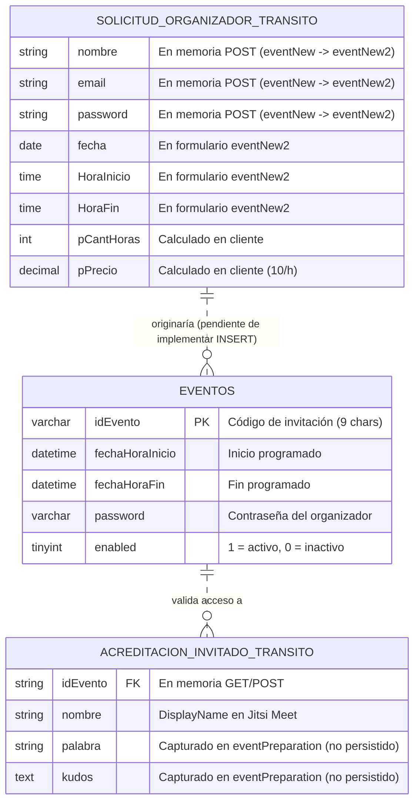

# 01 · Modelo de Datos y Persistencia

**Requisitos cubiertos:** `RF-03`, `RF-04`, `RF-08`, `RF-11`, `RNF-01`, `RNF-04`, `RNF-05`, `RNF-08`.

---

## 1. Motor de Base de Datos y Esquema de Conexión

El sistema utiliza una base de datos relacional **MySQL / MariaDB** accedida mediante la extensión `mysqli` en estilo procedural (`db.php`):

- **Entorno Local (`$_SERVER['HTTP_HOST'] == 'localhost'`):**
  - Servidor: `localhost`
  - Esquema / Base de datos: `eventosonline`
  - Usuario: `root` (sin contraseña)
- **Entorno de Producción (cualquier otro `HTTP_HOST`):**
  - Servidor: `127.0.0.1:3306`
  - Esquema / Base de datos: `u269343228_eventosonline` (anteriormente `id15295825_eventosonline`)
  - Usuario: `u269343228_Fiestasonline`

> **Nota sobre migraciones:** El repositorio no incluye un archivo `.sql` de definición de esquema (DDL) ni sistema de migraciones (el archivo histórico `EJEMPLOSQL.txt` fue eliminado en el commit `e2630d10eb2780380249fbf9f9cda1c3f7f9caf7`). El esquema documentado a continuación se ha reconstruido de forma exacta a partir de las consultas SQL en `eventValidate.php` y `EJEMPLOS.txt` y de los formularios de captura de datos.

---

## 2. Tablas Persistidas en Base de Datos

### 2.1. Tabla `eventos` (referenciada también como `Eventos` en `EJEMPLOS.txt`)

Representa cada evento o fiesta online registrada en la plataforma y su ventana temporal de celebración.

| Columna | Tipo Inferido (MySQL) | Nulabilidad | Descripción Funcional | Evidencia en Código |
| :--- | :--- | :--- | :--- | :--- |
| `idEvento` | `VARCHAR(11)` / `CHAR(9)` (PK / Unique) | `NOT NULL` | Código alfanumérico único del evento utilizado por los invitados para entrar y como `roomName` en Jitsi Meet. En `index.php` se valida con 9 caracteres (`[a-zA-Z0-9]{9}`) para invitados y 11 caracteres (`[a-z0-9]{11}`) en el bloque de administración. | `eventValidate.php` (línea 58-59), `index.php` (líneas 63, 89) |
| `fechaHoraInicio` | `DATETIME` | `NOT NULL` | Fecha y hora programada de comienzo del evento. Sobre ella se aplica `DATE_ADD(fechaHoraInicio, INTERVAL -30 MINUTE)` para calcular la apertura de puertas. | `eventValidate.php` (línea 58) |
| `fechaHoraFin` | `DATETIME` | `NOT NULL` | Fecha y hora de finalización del evento. Se compara con `NOW()` (`fechaHoraFin >= NOW()`) para determinar si el evento sigue vigente. | `eventValidate.php` (líneas 58, 60) |
| `password` | `VARCHAR(255)` | `NOT NULL` | Contraseña del organizador asociada al evento. Se recupera en `SELECT` en `eventValidate.php` y `EJEMPLOS.txt`. | `eventValidate.php` (línea 58), `EJEMPLOS.txt` (línea 19) |
| `enabled` | `TINYINT(1)` / `BOOLEAN` | `NOT NULL` | Indicador de activación del evento (`1` = activo/habilitado, `0` = inactivo). Solo los eventos con `enabled = 1` permiten el acceso de invitados. | `eventValidate.php` (línea 59) |

#### DDL Reconstruido de la Tabla `eventos`

```sql
CREATE TABLE IF NOT EXISTS `eventos` (
  `idEvento` VARCHAR(11) NOT NULL,
  `fechaHoraInicio` DATETIME NOT NULL,
  `fechaHoraFin` DATETIME NOT NULL,
  `password` VARCHAR(255) NOT NULL,
  `enabled` TINYINT(1) NOT NULL DEFAULT 1,
  PRIMARY KEY (`idEvento`),
  INDEX `idx_eventos_acceso` (`idEvento`, `enabled`, `fechaHoraFin`)
) ENGINE=InnoDB DEFAULT CHARSET=utf8mb4 COLLATE=utf8mb4_unicode_ci;
```

---

## 3. Entidades en Tránsito (Sin Persistencia Actual en Código)

El análisis del código fuente revela dos estructuras de datos capturadas en formularios que **no cuentan aún con sentencia `INSERT` ni tablas asociadas en las consultas SQL del repositorio**:

### 3.1. Solicitud de Nuevo Evento y Datos de Organizador (`eventNew.php` -> `eventNew2.php`)

Datos transportados mediante `POST` entre el Paso 1 y el Paso 2 del asistente de creación de eventos:

| Campo POST | Tipo en Formulario | Origen | Destino Actual |
| :--- | :--- | :--- | :--- |
| `nombre` | `text` | `eventNew.php` | `<input type="hidden" name="nombre">` en `eventNew2.php` |
| `email` | `email` | `eventNew.php` | `<input type="hidden" name="email">` en `eventNew2.php` |
| `password` | `password` | `eventNew.php` | `<input type="hidden" name="password">` en `eventNew2.php` |
| `reptpassword` | `password` | `eventNew.php` | Validado en cliente (`eventNew.php`), no reenviado desde `eventNew2.php` |
| `fecha` | `date` | `eventNew2.php` | `action="#"` (sin persistencia implementada) |
| `HoraInicio` | `time` | `eventNew2.php` | `action="#"` (sin persistencia implementada) |
| `HoraFin` | `time` | `eventNew2.php` | `action="#"` (sin persistencia implementada) |
| `pCantHoras` | `text` (`readonly`) | `eventNew2.php` | Calculado en JS (`parseInt(cantidadHoras)`), sin persistencia |
| `pPrecio` | `text` (`readonly`) | `eventNew2.php` | Calculado en JS (`10 * h`), sin persistencia |

### 3.2. Participación y Dedicatoria de Invitado (`eventPreparation.php` -> `fiestaPrincipal.php`)

Datos capturados cuando el invitado supera la validación horaria y pasa por la antesala:

| Campo POST/GET | Tipo en Formulario | Origen | Uso Real en `fiestaPrincipal.php` |
| :--- | :--- | :--- | :--- |
| `idEvento` | `hidden` (recibido por `GET`) | `eventPreparation.php` | Usado como `roomName` y `APP_NAME` en Jitsi Meet (`fiestaPrincipal.php`, líneas 14, 31, 44). |
| `nombre` | `text` (`pattern="[a-zA-Z0-9 ]{3,}"`) | `eventPreparation.php` | Usado como `userInfo.displayName` en Jitsi Meet (`fiestaPrincipal.php`, líneas 15, 53). |
| `palabra` | `text` (`pattern="[a-zA-Z]{3,}"`) | `eventPreparation.php` | **Ignorado:** No se lee en `fiestaPrincipal.php` ni se guarda en base de datos. |
| `kudos` | `textarea` | `eventPreparation.php` | **Sin persistencia:** Se asigna a `$kudos = $_POST["kudos"]` en `fiestaPrincipal.php` (línea 16), pero su impresión está comentada y no se almacena en MySQL. |

---

## 4. Diagrama Entidad-Relación (Estado Real vs. Dominio Implícito)



---

## 5. Consultas SQL en Producción y Análisis de Seguridad/Rendimiento

### 5.1. Consulta de Validación de Evento (`eventValidate.php`, líneas 58-60)

```sql
SELECT idEvento, fechaHoraInicio, fechaHoraFin, password, fechaHoraInicio,
       DATE_ADD(fechaHoraInicio, INTERVAL -30 MINUTE) AS 'inicioPermitido'
FROM eventos
WHERE idEvento = '$idEvento'
  AND enabled = 1
  AND fechaHoraFin >= NOW()
```

**Observaciones técnicas:**
1. **Columna duplicada en proyección:** `fechaHoraInicio` se selecciona dos veces en la cláusula `SELECT`.
2. **Exposición innecesaria de `password`:** La consulta recupera la columna `password` aunque `eventValidate.php` solo valida el acceso de invitados por `idEvento` y no utiliza la contraseña para nada.
3. **Vulnerabilidad de Inyección SQL:** `$idEvento` proviene directamente de `$_POST["idEvento"]` sin parametrizar. Un atacante puede enviar `' OR 1=1 LIMIT 1 -- ` para eludir la validación de `idEvento`, `enabled` y `fechaHoraFin`.
4. **Sensibilidad a mayúsculas/minúsculas en el nombre de tabla:** En `eventValidate.php` se consulta `FROM eventos` (en minúscula), mientras que en `EJEMPLOS.txt` (línea 3) figura `FROM Eventos` (con mayúscula inicial). En servidores Linux con MySQL (`lower_case_table_names=0`), el nombre real de la tabla debe ser exactamente `eventos`.
