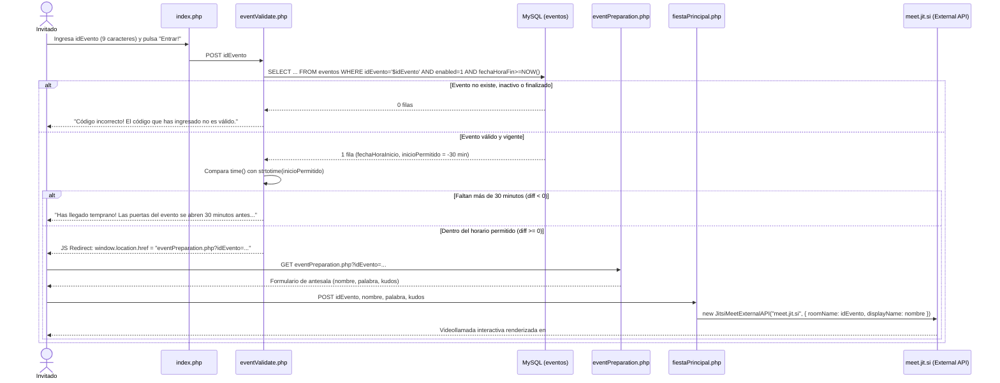

# 02 · Acceso de Invitados y Sala de Videoconferencia

**Requisitos cubiertos:** `RF-01`, `RF-03`, `RF-04`, `RF-05`, `RF-06`, `RNF-02`, `RNF-03`, `RNF-04`, `RNF-06`, `RNF-07`, `RNF-08`.

---

## 1. Visión General del Módulo

Este módulo implementa el recorrido principal en producción del sistema: el acceso de un invitado a un evento online activo mediante su código de invitación (`idEvento`), la verificación de vigencia y horario de apertura de puertas, la captura de sus datos de identificación y dedicatoria en la antesala, y su entrada a la sala de videoconferencia WebRTC embebida mediante **Jitsi Meet**.

### Secuencia del Flujo de Invitado



---

## 2. Especificación de Pantallas y Endpoints

### 2.1. Formulario de Acceso de Invitado (`index.php`, líneas 58-72)

- **Ruta:** `GET /index.php` (o `/`)
- **Acción del formulario:** `POST eventValidate.php`
- **Campos de entrada:**
  - `idEvento` (`type="text"`):
    - `placeholder`: `"Aqui tu código! (ej. <SCMDDFESF>)"`
    - `pattern`: `[a-zA-Z0-9]{9}` (exactamente 9 caracteres alfanuméricos, sin espacios).
    - `title`: `"Revise el código que se le ha dado. No incluyas los espacios en blanco."`
    - *Observación:* No incluye el atributo HTML `required`, por lo que si el usuario pulsa `"Entrar!"` con el campo vacío, el navegador permite enviar `idEvento=""` a `eventValidate.php`.

### 2.2. Validador de Invitación y Horario (`eventValidate.php`)

- **Ruta:** `POST /eventValidate.php`
- **Parámetros recibidos (`$_POST`):**
  - `idEvento` (`string`): Código del evento introducido por el invitado.
- **Lógica de negocio ejecutada:**
  1. Abre conexión a MySQL a través de `require 'menu.php'` (que incluye `db.php`).
  2. Ejecuta consulta sobre la tabla `eventos` filtrando por:
     - `idEvento = '$idEvento'`
     - `enabled = 1`
     - `fechaHoraFin >= NOW()`
  3. Calcula en SQL la columna derivada `inicioPermitido = DATE_ADD(fechaHoraInicio, INTERVAL -30 MINUTE)`.
  4. **Caso A — Sin coincidencias (`mysqli_num_rows($result) == 0`):**
     - Renderiza con el avatar `images/robotsmall.png` (*"Robotcete dice..."*) el mensaje:
       > `<h4>Código incorrecto!</h4><p>El código que has ingresado no es válido.</p>.`
  5. **Caso B — Evento vigente pero fuera de ventana de apertura (`time() - strtotime($row['inicioPermitido']) < 0`):**
     - Renderiza:
       > `<h4>Has llegado temprano!</h4><p>Las puertas del evento se abren 30 minutos antes del comienzo...</p>.`
  6. **Caso C — Evento vigente y en horario permitido (`$diff >= 0`):**
     - Imprime un bloque `<script>` que redirige en cliente:
       ```javascript
       window.location.href = "eventPreparation.php?idEvento=<idEvento>";
       ```
     - Renderiza simultáneamente `<h4>Puedes pasar!</h4>`.
  7. Libera el resultado (`mysqli_free_result`) y cierra la conexión (`mysqli_close($link)`).
  8. Muestra un botón `"Volver a página principal"` (`POST index.php`).

### 2.3. Antesala y Preparación del Invitado (`eventPreparation.php`)

- **Ruta:** `GET /eventPreparation.php?idEvento=<idEvento>`
- **Parámetros recibidos (`$_GET`):**
  - `idEvento` (`string`): Código del evento validado.
- **Interfaz y Formulario (`POST fiestaPrincipal.php`):**
  - Muestra imagen `images/invited.jpg` y texto de bienvenida explicando que se solicitan datos para identificarle y preparar una sorpresa.
  - **Campos del formulario:**
    1. `idEvento` (`type="Hidden"`, `value="<?=$_GET["idEvento"];?>"`): Conserva el identificador del evento.
    2. `nombre` (`type="text"`):
       - `placeholder`: `"Nombre... o como quieres que te identifiquen en el evento..."`
       - `pattern`: `[a-zA-Z0-9 ]{3,}` (mínimo 3 caracteres alfanuméricos o espacios; no admite tildes ni `ñ` si se rellena, aunque carece de `required`).
       - `title`: `"Debe ingresar un nombre válido."`
    3. `palabra` (`type="text"`):
       - `placeholder`: `"Una palabra que describa al agazajado..."`
       - `pattern`: `[a-zA-Z]{3,}` (una sola palabra de al menos 3 letras ASCII, sin espacios ni tildes; carece de `required`).
       - `title`: `"Sólo una palabra! ;)"`
    4. `kudos` (`<textarea name="kudos" id="kudos">`):
       - Mensaje libre opcional de saludo, felicitación o *kudos* para el organizador. Nota: el `<textarea>` contiene saltos de línea y tabulaciones por defecto entre sus etiquetas de apertura y cierre.

### 2.4. Sala Principal del Evento y Videollamada (`fiestaPrincipal.php`)

- **Ruta:** `POST /fiestaPrincipal.php`
- **Parámetros recibidos (`$_POST`):**
  - `idEvento` (`string`): Identificador del evento y nombre de sala en Jitsi.
  - `nombre` (`string`): Nombre para mostrar del invitado en la videollamada.
  - `kudos` (`string`): Recibido en `$kudos = $_POST["kudos"]`, pero no utilizado.
  - *(Nota: `$_POST["palabra"]` no es leído en este script).*
- **Integración con Jitsi Meet External API:**
  - Carga el script oficial `https://meet.jit.si/external_api.js`.
  - Al dispararse `$(function() { StartMeeting(); })` (evento DOM ready de jQuery), verifica que `#flagshowvideo` tenga el valor `'si'`, instancia `JitsiMeetExternalAPI` y cambia `#flagshowvideo` a `'no'`.
  - **Parámetros de configuración de Jitsi (`options`):**
    - `domain`: `'meet.jit.si'`
    - `roomName`: `"<?= $idEvento ?>"`
    - `width`: `screen.width - (screen.width / 5)` (80 % de la anchura de la pantalla del usuario)
    - `height`: `400` (píxeles)
    - `parentNode`: `document.querySelector('#jitsi-meet-conf-container')`
    - `hideLobbyButton`: `true`
    - `requireDisplayName`: `false`
    - `enableWelcomePage`: `false`
    - `disableInviteFunctions`: `true`
    - `interfaceConfigOverwrite`:
      - `APP_NAME`: `'<?=$idEvento?>'`
      - `JITSI_WATERMARK_LINK`: `'https://google.com'`
      - `DISPLAY_WELCOME_PAGE_CONTENT`: `false`
    - `userInfo`:
      - `displayName`: `'<?=$nombre?>'`

---

## 3. Hallazgos Técnicos y Casos de Borde Detectados

1. **Bypass de validación accediendo directamente a `eventPreparation.php` o `fiestaPrincipal.php`:**
   - Ni `eventPreparation.php` ni `fiestaPrincipal.php` comprueban en servidor si el `idEvento` fue previamente validado en `eventValidate.php` o si el evento existe en base de datos. Cualquier usuario puede enviar una petición `POST` directa a `fiestaPrincipal.php` con un `idEvento` arbitrario y abrirá una sala en `meet.jit.si`.
2. **Restricción de caracteres españoles en `eventPreparation.php`:**
   - Los atributos `pattern="[a-zA-Z0-9 ]{3,}"` (en `nombre`) y `pattern="[a-zA-Z]{3,}"` (en `palabra`) rechazan caracteres con tilde (`á`, `é`, `í`, `ó`, `ú`), diéresis o la letra `ñ`/`Ñ`, habituales en nombres y adjetivos en español.
3. **Ausencia de persistencia de `palabra` y `kudos`:**
   - Pese a solicitarse en `eventPreparation.php` con el propósito declarado de *"preparar una sorpresa"* y *"dejar un mensaje para el organizador"*, estos datos se pierden al cargar `fiestaPrincipal.php`.
4. **Vulnerabilidad XSS en `eventPreparation.php` y `fiestaPrincipal.php`:**
   - En `eventPreparation.php` se inyecta `$_GET["idEvento"]` sin escapar en `value="<?=$_GET["idEvento"];?>"`.
   - En `fiestaPrincipal.php` se inyectan `$idEvento` y `$nombre` directamente dentro de literales de cadena JavaScript (`roomName: "<?= $idEvento?>"`, `displayName: '<?=$nombre?>'`).
