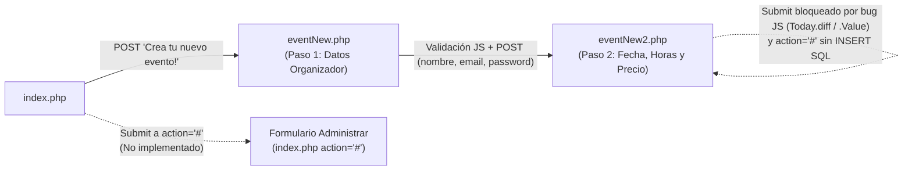

# 03 · Organización, Presupuestación y Administración de Eventos

**Requisitos cubiertos:** `RF-01`, `RF-02`, `RF-07`, `RF-08`, `RF-09`, `RF-10`, `RF-12`, `RNF-02`, `RNF-05`, `RNF-06`.

---

## 1. Visión General del Módulo

Este módulo agrupa las funcionalidades orientadas al **Organizador de Eventos**:
1. **Solicitud de nuevo evento en dos pasos (`eventNew.php` -> `eventNew2.php`):** Captura los datos personales y credenciales del organizador en un primer paso, y la fecha, hora de inicio y hora de fin en un segundo paso, calculando en tiempo real el número de horas y el presupuesto del evento.
2. **Acceso de administración de evento (`index.php`):** Formulario en la página principal para que el organizador acceda a la gestión de su evento mediante código y contraseña.
3. **Navegación transversal y páginas estáticas (`menu.php`, `footer.php`, `generic.php`).**

### Diagrama de Flujo del Organizador (Estado Real en Código)



---

## 2. Asistente de Creación de Nuevo Evento

### 2.1. Paso 1: Datos del Organizador (`eventNew.php`)

- **Ruta:** `GET` / `POST /eventNew.php` (invocado desde el botón de `index.php` o desde el enlace de `menu.php`).
- **Formulario:** `id="Formulario"`, `method="post"`, `action="eventNew2.php"`.
- **Campos de entrada:**
  - `nombre` (`type="text"`, `placeholder="* Nombre y apellidos"`)
  - `email` (`type="email"`, `placeholder="* Email"`)
  - `password` (`type="password"`, `placeholder="* Contraseña"`)
  - `reptpassword` (`type="password"`, `placeholder="* Repetir Contraseña"`)
- **Reglas de validación en cliente (`validarFormulario` en `eventNew.php`, líneas 22-58):**
  - Intercepta el evento `submit` con `evento.preventDefault()`.
  - Si `nombre.length == 0`: muestra `alert('Es necesario que ingrese su nombre completo')` y detiene el envío.
  - Si `email.length == 0`: muestra `alert('Debe ingresar un correo electrónico válido.')` y detiene el envío.
  - Si `password.length == 0`: muestra `alert('Debe ingresar una contraseña.')` y detiene el envío.
  - Si `reptpassword.length == 0`: muestra `alert('Debe volver a escribir la contraseña.')` y detiene el envío.
  - Si `reptpassword != password`: muestra `alert('Los campos de contraseña no coinciden.')` y detiene el envío.
  - Si todas las comprobaciones pasan, invoca `this.submit()` enviando los datos por `POST` a `eventNew2.php`.

### 2.2. Paso 2: Planificación Horaria y Cálculo de Presupuesto (`eventNew2.php`)

- **Ruta:** `POST /eventNew2.php`
- **Recepción de parámetros del Paso 1 (`$_POST`, líneas 121-123):**
  - `$nombre = $_POST["nombre"];`
  - `$email = $_POST["email"];`
  - `$password = $_POST["password"];`
  - Estos tres valores se insertan en campos ocultos `<input type="hidden">` dentro del formulario del Paso 2 (líneas 168-170).
- **Campos del formulario (`id="Formulario"`, `method="post"`, `action="#"`):**
  - `fecha` (`type="date"`): Fecha del evento.
  - `HoraInicio` (`type="time"`): Hora de comienzo del evento (`HH:MM`).
  - `HoraFin` (`type="time"`): Hora de fin del evento (`HH:MM`).
  - `pCantHoras` (`type="text"`, `readonly`): Cantidad de horas calculada.
  - `pPrecio` (`type="text"`, `readonly`): Importe total calculado.

#### Algoritmo de Cálculo de Horas y Precio (`calcularHoras()` y `calcularPrecio()`)

1. Se dispara en el evento `change` de `#HoraInicio` y `#HoraFin`.
2. Extrae las horas (`substr(0,2)`) y minutos (`substr(3,2)`) tanto de `HoraInicio` como de `HoraFin`.
3. Calcula `transcurridoHoras = finHoras - inicioHoras` y `transcurridoMinutos = finMinutos - inicioMinutos`. Si `transcurridoMinutos < 0`, resta 1 a `transcurridoHoras` y suma 60 a `transcurridoMinutos`.
4. Obtiene el valor decimal `cantidadHoras = parseInt(horas) + (parseInt(minutos) / 60)`.
5. **Validación de rango horario:**
   - Si `cantidadHoras < 0` (la hora de fin es anterior a la de inicio en el mismo día):
     - Muestra `alert('Debe seleccionar una hora de fin posterior a la de inicio.')`.
     - Reinicia `HoraFin.value = 0`, `HoraInicio.value = 0` y `pCantHoras.value = 0`.
     - Llama a `calcularPrecio()` (que establece `pPrecio.value = 0`).
   - Si `cantidadHoras >= 0`:
     - Asigna la parte entera `parseInt(cantidadHoras)` a `pCantHoras.value` (nota: las fracciones de hora se truncan al convertir con `parseInt`).
     - Si el resultado es `"NaN"` (por ejemplo, cuando aún falta por rellenar una de las dos horas), fuerza `pCantHoras.value = 0`.
     - Llama a `calcularPrecio()`, que multiplica `parseInt(pCantHoras.value)` por la constante PHP `$preciohora = 10` (`p.value = 10 * h`).

#### Discrepancias y Defectos Bloqueantes en `eventNew2.php`

1. **Error en tiempo de ejecución en `validarFormulario` (líneas 34-44):**
   ```javascript
   function validarFormulario(evento) {
       evento.preventDefault();
       var selected = new Date(document.getElementById("fecha").value + " " + document.getElementById("HoraInicio").Value);
       var Today = new Date(Date.now());
       if(Today.diff(selected, 'hours')< 0){
           alert('La fecha y hora seleccionada no puede ser anterior al día de hoy.');
           return;
       }
       this.submit();
   }
   ```
   - `document.getElementById("HoraInicio").Value` utiliza `V` mayúscula en lugar de `.value`, devolviendo `undefined` y generando un `Invalid Date`.
   - `Today.diff(...)` no es un método estándar de `Date` en JavaScript (pertenece a librerías como Moment.js, que no está incluida en el proyecto), por lo que lanza `Uncaught TypeError: Today.diff is not a function` tras haber ejecutado `evento.preventDefault()`, impidiendo que el formulario llegue nunca a `this.submit()`.
2. **Ausencia de persistencia en servidor:**
   - El formulario apunta a `action="#"` y `eventNew2.php` no contiene código PHP para procesar el segundo `POST`, generar el código `idEvento` ni ejecutar `INSERT INTO eventos`.

---

## 3. Acceso de Administración de Eventos (`index.php`, líneas 84-105)

En la parte inferior de `index.php` se presenta la sección **"Eres el organizador de un evento, entra aqui para administrar:"**:

- **Estado de implementación:** Maqueta HTML sin funcionalidad conectada (`action="#"`).
- **Problemas detectados en el código actual:**
  - El campo de código de evento (`type="text"`) y el campo de contraseña (`type="password"`) tienen exactamente los mismos atributos `name="demo-name"` e `id="demo-name"` (heredados de la plantilla de demostración de HTML5 UP).
  - El patrón de validación del código es `pattern="[a-z0-9]{11}"` (11 caracteres en minúscula o dígitos, con un ejemplo con espacios `<SCM DDF ESF>` que ni siquiera cumpliría dicho patrón), contradiciendo el patrón de 9 caracteres alfanuméricos (`[a-zA-Z0-9]{9}`) del formulario de invitados.
  - El campo `<input type="password">` tiene asignada la clase de botón `class="primary"`.

---

## 4. Navegación Común y Páginas Auxiliares (`menu.php`, `footer.php`, `generic.php`)

- **`menu.php`:**
  - Ejecuta `include 'db.php';` en la línea 2.
  - Define el menú `<nav id="menu">` con 6 enlaces:
    - `Inicio` -> `index.php` (Operativo)
    - `Entrar a un evento` -> `index.html` (Enlace roto / 404)
    - `Administrar mi evento` -> `index.html` (Enlace roto / 404)
    - `Crea un nuevo evento` -> `eventNew.php` (Operativo)
    - `Ayuda!` -> `index.html` (Enlace roto / 404)
    - `¿Quienes somos?` -> `index.html` (Enlace roto / 404)
- **`footer.php`:**
  - Pie de página común con copyright `&copy; 2020. All rights reserved | Design: Whitchoo`. Conserva comentado el formulario de contacto y enlaces sociales de la plantilla Phantom.
- **`generic.php`:**
  - Página estática con contenido *Lorem ipsum* e imagen `images/pic13.jpg` (nota: `images/pic13.jpg` no existe en `/images/`, sino en `/CSSPhantom/images/pic13.jpg`, por lo que la imagen en `generic.php` devuelve 404).
